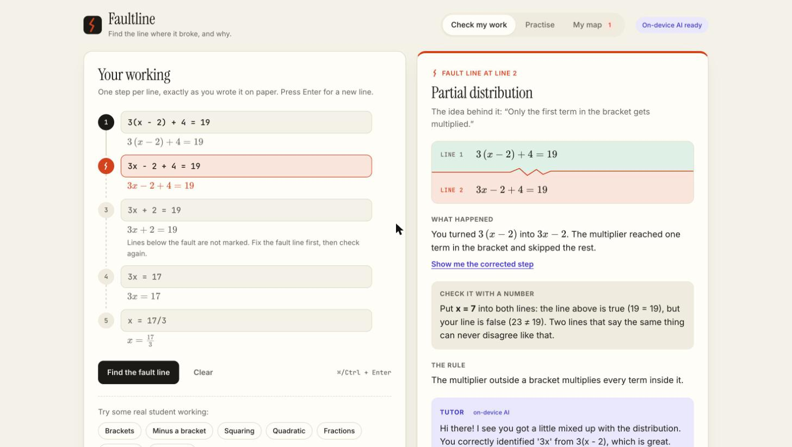
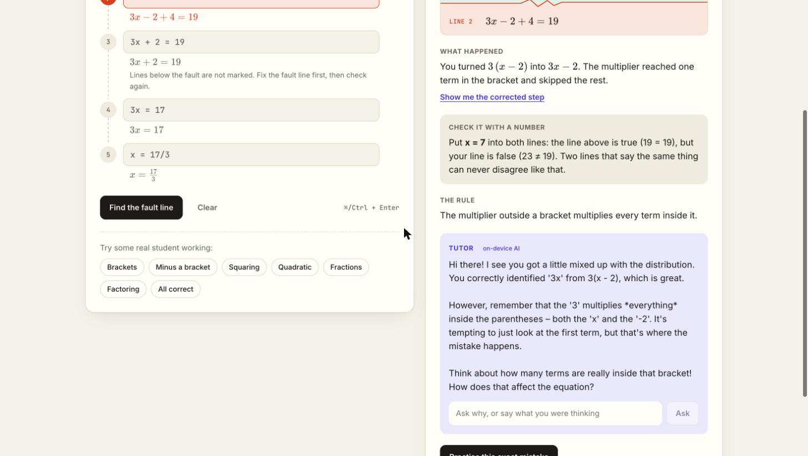
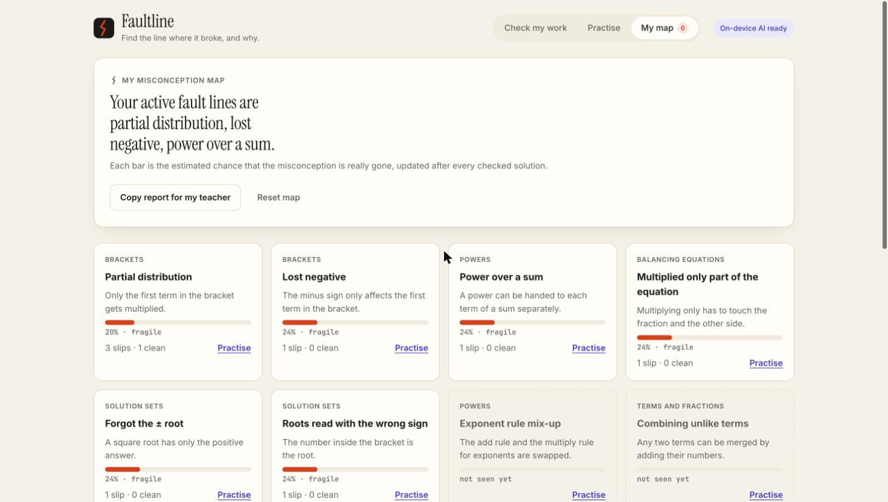

# Faultline

**Find the line where it broke, and why.**

Faultline is a maths tutor that reads a student's working line by line, finds the exact line where the reasoning went wrong, and names the misconception behind it. Then it helps the student repair that one idea and tracks whether it is really gone.

**Live demo:** https://vaibhavshintre.github.io/faultline/

**Demo video (2 min):** https://youtu.be/IyGiH8KBOoE



| The on-device tutor | The misconception map |
|---|---|
|  |  |

## The problem

A red cross next to a final answer tells a student nothing. Research on error analysis in mathematics education is consistent on this point: most wrong answers in algebra come from a small set of stable, predictable wrong rules ("mal-rules"), not from random carelessness. A student who believes that `2(x + 3)` is `2x + 3` will keep losing marks until someone points at that belief.

Teachers can do this for one student at a time. Answer-checking apps cannot do it at all, and general chatbots do it unreliably because they re-derive the maths themselves and sometimes get it wrong.

## What Faultline does

1. **Exact checking.** Every line is compared with the line above it using exact symbolic arithmetic. Two equations are equivalent when they have the same solution set, and two expressions are equivalent when they are equal as rational functions. The first line that changes the meaning is the fault line. A correct line is never marked wrong.
2. **Diagnosis by model tracing.** A library of documented wrong rules is replayed on the student's previous line. If a wrong rule reproduces what the student wrote, that rule is the diagnosis. Comparison is by mathematical equivalence, not spelling, so the student can have tidied up in the same line and still be matched.
3. **A number check the student can do by hand.** Faultline finds a concrete value where the two lines disagree ("put x = 7 into both lines: 19 = 19, but 23 ≠ 19").
4. **An on-device tutor.** A language model running inside the browser explains the mistake in the student's own numbers and asks a question back. It is given only facts the engine has already verified, and it is told never to give away the answer.
5. **Targeted practice.** One click generates a fresh problem built to tempt that exact mistake. Each generator is self-tested: the engine confirms that the tempting wrong step really is diagnosed as that misconception before the problem is shown.
6. **A misconception map.** Bayesian Knowledge Tracing estimates, for each misconception, the probability that it is gone. Students can copy a plain-text report for their teacher.

## Where the AI is

| Technique | Role |
|---|---|
| Model tracing with mal-rules (the method behind cognitive tutors) | Decides *which* misconception explains a wrong step |
| Symbolic algebra over exact rationals, with numeric root finding | Decides *whether* a step is valid, with no false alarms |
| Bayesian Knowledge Tracing (a hidden-Markov learner model) | Estimates mastery of each misconception over time |
| Gemini Nano through Chrome's built-in Prompt API | Explains the diagnosis conversationally and answers follow-up questions |

The division of labour is deliberate. The language model never marks anything. It receives a list of verified facts and turns them into a short, warm explanation. This removes the main failure of chatbot tutors, which is confidently marking correct work wrong or wrong work correct.

Because the model runs on the device, there is no API key, no server and no cost per student, and the student's work never leaves the browser. In a browser without a built-in model, Faultline still works fully: the diagnosis, the number check, the rule and the practice loop all come from the engine.

## Misconceptions it recognises

Brackets: partial distribution, lost negative. Powers: power over a sum, exponent rule mix-ups. Terms and fractions: combining unlike terms, adding fractions straight across, cancelling inside a sum. Balancing equations: moving a term without changing its sign, dividing or multiplying only part of an equation, using the wrong inverse operation. Solution sets: zero-product rule without a zero, forgetting the ± root, reading roots with the wrong sign, losing a solution, picking up an extra one. Slips: sign slips, arithmetic slips and dropped terms, each pinpointed to the exact number or term.

## Try it

Open the live demo and click one of the "real student working" chips, or type your own working, one step per line:

```
3(x - 2) + 4 = 19
3x - 2 + 4 = 19
3x + 2 = 19
3x = 17
x = 17/3
```

For the conversational tutor, use desktop Chrome 138 or later. The first use may download the on-device model.

## Run it locally

```bash
npm install
npm run dev      # start the app
npm test         # run the engine tests
npm run build    # production build in dist/
```

## How the code is organised

```
src/engine/rational.ts   exact fractions on BigInt
src/engine/ast.ts        expression parser, printers (text and TeX), tree rewriting
src/engine/poly.ts       multivariate polynomials, rational functions, exact surds
src/engine/line.ts       lines of working, equivalence, root finding, number checks
src/engine/malrules.ts   the mal-rule library and the diagnosis procedure
src/engine/analyze.ts    walks a whole piece of working and finds the fault line
src/engine/catalog.ts    names, principles and built-in explanations
src/engine/bkt.ts        Bayesian Knowledge Tracing
src/engine/practice.ts   self-verifying practice generators
src/ai.ts                on-device tutor (Chrome Prompt API)
src/App.tsx, src/components/   the interface (React)
tests/engine.test.ts     engine tests
```

The engine has no dependencies and no network access. The interface uses React and KaTeX.

## Limits

- The checker covers school algebra: polynomial and rational expressions, linear and polynomial equations in one variable, and square roots of constants. Trigonometry, logarithms, inequalities and systems of equations are not supported yet.
- A wrong step that combines two different mistakes in one line is reported as unrecognised, with the number check still shown.
- The conversational tutor needs a browser with a built-in model. Everything else works anywhere.

## Built with

TypeScript, React, Vite, KaTeX, Vitest, and Chrome's built-in Prompt API. Written during SLAY HACKS 2026 with AI coding assistance (Claude Code).

## Licence

MIT
