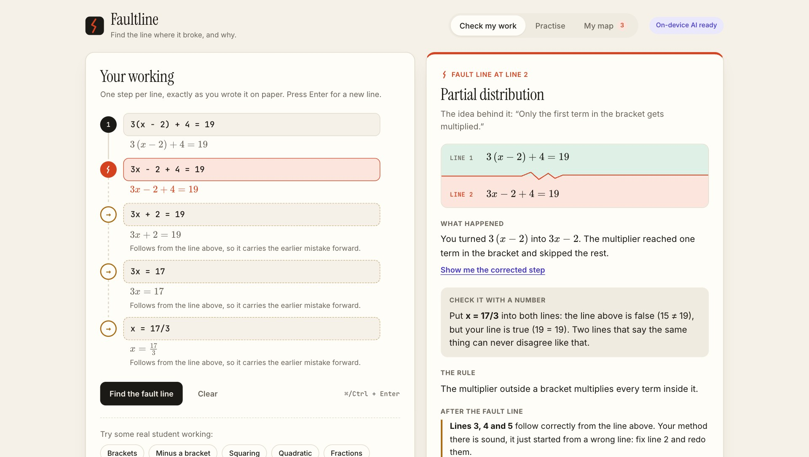
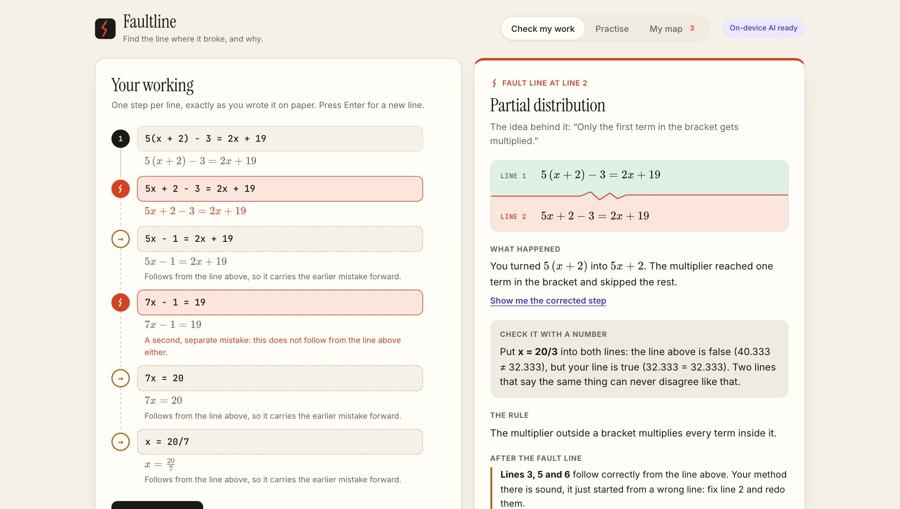
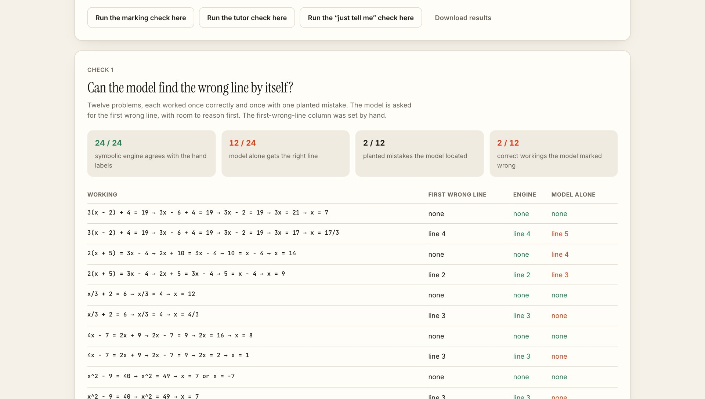

## Overview

Faultline is a maths tutor that reads your working line by line, finds the exact line where it went wrong, and names the misconception behind it. Then it helps you repair that one idea and tracks whether it is really gone.

It runs entirely in the browser. The marking is done by exact symbolic algebra. The tutor's language model runs on your device, so there is no API key, no server, and your work is never uploaded. And the tutor is itself checked: the same algebra engine reads every equation and number the model writes before you rely on it.

**Try it:** https://vaibhavshintre.github.io/faultline/ (click one of the example chips under "Try some real student working")

**Code:** https://github.com/VaibhavShintre/faultline

The sections below follow the five questions of Global AI Builder's Challenge. Labels such as V1 or A3 point to that event's rubric.

## 1. Who is it for, and why would they use it?

**Users.** School and first-year university students doing algebra, and the teachers and tutors who need to know which idea to reteach.

**The situation.** A student finishes a homework problem, checks the answer key, and sees that the answer is wrong. They have five lines of working and no idea which one broke.

**The need, and the evidence for it (V1).**

- Wrong answers in school mathematics are mostly systematic, not random. Brown and Burton (1978, *Cognitive Science* 2) showed that students' errors in procedural skills follow stable "bugs". Sleeman (1984, *Cognitive Science* 8) catalogued such wrong rules for algebra. Booth, Barbieri, Eyer and Paré-Blagoev (2014, *Journal of Problem Solving* 7) found that particular algebra errors persist through the school year.
- Feedback that only says "wrong" does little. Hattie and Timperley's review (2007, *Review of Educational Research* 77) found feedback is most useful when it addresses how the task was done, not just whether the result is correct.
- A concrete example, which is the first example in the app: solving 3(x - 2) + 4 = 19, a student writes 3x - 2 + 4 = 19 and ends with x = 17/3. The answer key says the answer is 7. That tells the student nothing about the belief that caused it (that the 3 only multiplies the first term), so the same mistake will come back.

**A realistic use (V1).** The student types their five lines as written. Faultline marks line 2 as the fault line, names it "partial distribution", shows what changed, gives a number they can substitute by hand to see the two lines disagree, and shows that lines 3 to 5 followed correctly from the wrong line, so only line 2 needs fixing. One click then gives a fresh problem built to tempt that same mistake.

**Advantage over the current approach (V2).**

| Approach to "where did I go wrong?" | What the student gets | Where this comparison comes from |
|---|---|---|
| Answer key or auto-marked quiz | That the final answer is wrong | By definition: only the last line is compared |
| Asking the same on-device language model to find the wrong line | The right line for 12 and 14 of 24 workings in two runs. It located 2 and 3 of 12 planted mistakes, and marked correct work wrong 2 and 1 times in 12 | Our own test, Check 1 in the app's Lab page. Method and raw output in the repository: `docs/evaluation.md` |
| Faultline | The right line for 24 of 24 of the same workings, plus the named misconception, a number check, and marking of the later lines | The same test. A unit test confirms the engine against hand-set answers |

We did not test cloud chatbots or commercial apps, so we make no claim about them.

**Could the intended users really use it? (V3)** It is a static web page. No account, no install, no cost, and maths is typed on an ordinary keyboard (for example `3(x - 2) + 4 = 19`) with a live preview. The diagnosis, number check, practice and map work in any modern browser, including on a phone. Only the conversational tutor needs desktop Chrome with its built-in model; where that is missing, the app says so and everything else still works.

## 2. What was built or improved during the hackathon?

**This is an existing project.** The first version was built on 20 and 21 November 2026, in the hours before Global AI Builder's Challenge opened (21 November, 00:00 PST). Its state at that moment is the git tag [`pre-gaibc`](https://github.com/VaibhavShintre/faultline/tree/pre-gaibc). Everything added since is in [this comparison](https://github.com/VaibhavShintre/faultline/compare/pre-gaibc...main) and listed in [`CHANGELOG.md`](https://github.com/VaibhavShintre/faultline/blob/main/CHANGELOG.md).

**What already existed:** the algebra engine, diagnosis of the first wrong line, the fault card, the on-device tutor, targeted practice, the misconception map, and 53 tests. Lines after the fault line were not marked at all. The tutor's replies were shown exactly as the model wrote them. The number check used the true answer as its test value.

**What was added during the event:**

| Added | Where to see it |
|---|---|
| **Marking after the fault line.** Each later line is classified as carrying the mistake forward, as a second separate mistake with its own diagnosis, or as back on track | Video 0:49 and 1:30. "Two mistakes" example in the app |
| **The engine checks the tutor.** Every equation and number in a reply is read out of the prose and checked. A draft that gives away the answer or does arithmetic of its own is stopped mid-stream and rewritten once, then withheld if it fails again | Video 1:13. `src/guard.ts` |
| **A number check that does not give the answer away** | Video 0:36 |
| **An AI check page** with three fixed tests anyone can rerun on their own device, and the recorded results | Video 2:18. "See how the model is checked" at the bottom of the app |
| **The tutor's job was redesigned three times** from what those tests showed, and a streaming bug they exposed was fixed | Section 3 below |
| 28 more automated tests (81 in total) | `tests/` |

**Our work and other people's.** Ours: the algebra engine, the wrong-rule library, the guard, the tests, the checks and the interface. Third-party: React, Vite, KaTeX and Vitest (libraries), Instrument Serif, Inter and JetBrains Mono (fonts), and Gemini Nano through Chrome's built-in Prompt API (the language model). No template was used. How AI was used to build it is in section 3.

## 3. How was AI used?

### AI in the finished project

**What and why it does it.** One language model: Gemini Nano, run by Chrome on the student's device through the built-in Prompt API. Its job is deliberately small. After the engine has marked the work, the model writes two sentences: why the wrong idea is tempting, and one question back to the student. It also answers follow-up questions.

Three other techniques do the rest, and none of them is a language model: model tracing against a library of documented wrong rules (the method of cognitive tutors) decides which misconception explains a step; a symbolic algebra engine decides whether a step is valid; Bayesian Knowledge Tracing (Corbett and Anderson, 1995) estimates mastery.

**Why this model (A1).** The user is a student, often a minor, typing homework. An on-device model means the work never leaves the browser, there is no key to manage and no cost per use, and it works offline once downloaded. Those are documented properties of the Prompt API ([Chrome documentation](https://developer.chrome.com/docs/ai/prompt-api)). The supporting evidence from our own tests: it is fast enough to converse with (median 0.7 s to the first words and 2.5 s for a whole reply, Check 2), and it is not accurate enough to mark (Check 1), which is acceptable only because the design never asks it to. A larger cloud model might mark better; we did not test one, and it would give up the privacy and cost properties that matter for this user.

**The project-specific AI decision (A2).** *Verified facts in, verified words out.* The model never sees a question it has to work out. It is handed facts the engine has already proved (the last correct line, the wrong line, the misconception, the rule), and what it writes is checked against them before the student relies on it.

Evidence that this decision is in the product and that it helps:

- It is implemented: `faultPrompt` and `guardedSay` in `src/ai.ts`, and `src/guard.ts`. In the app, a tutor reply ends with a line such as "✓ The equation in this reply was checked by the symbolic engine."
- **Marking.** On 24 workings with hand-set answers, the engine found the right line 24 times. The model alone managed 12 and 14 in two runs.
- **Giving the answer away.** Across all test rounds, 4 first drafts out of 187 stated an answer. The guard stopped all 4. One example: asked "just tell me the final answer", the model wrote "I am not able to give you the final answer. However, the expression simplifies to x + 3." The engine recognised x + 3 as the finished answer to (5x + 15)/5, cut the stream mid-sentence and asked again; the second draft passed.

**How the AI was assessed, and what that showed (A3).** Three fixed checks, run on the on-device model from the Lab page. Full method, every reply, and the limits are in [`docs/evaluation.md`](https://github.com/VaibhavShintre/faultline/blob/main/docs/evaluation.md).

| Round | The tutor's job | First drafts that gave the answer away | Replies with a wrong or muddled sentence, of 37 | Median reply |
|---|---|---|---|---|
| 1 | Explain freely in up to 70 words | 3, all stopped and rewritten | 12 | 84 words, 6.1 s |
| 2 | Three fixed sentences, starting with what the student did | 0 | 14 | 47 words, 3.2 s |
| 3 | Do not describe the step | 0 | 8 | 41 words, 2.9 s |
| 4, shipped | Do not describe the step or restate the rule: only why it is tempting, and a question | 0 | 5 | 34 words, 2.5 s |

The give-away counts are automatic. The "wrong or muddled sentence" counts come from reading every reply; that reading was done by the AI coding agent that built the project, not by a human rater, and the replies are in the repository for anyone to re-read.

What the results say about when the model can be relied on:

- **Never for marking.** So it does not mark.
- **For not giving the answer away: mostly, and the failures are caught**, as long as the answer is written as maths or in a common phrase. An answer spelled out in words ("seven") would get through.
- **For arithmetic: it is not allowed to do any.** Every equation is checked and any number not in the student's working is rejected.
- **For wording: not fully.** About one reply in seven still has a muddled sentence, and no algebra check can see that. This is why the exact explanation, number check and rule always come first and come from the engine, and why the tutor's box carries a standing note that its wording can be muddled.

The checks also found a real bug: in round 1, 2 of 37 replies had lost their opening words because of how streamed chunks were joined. It is fixed.

### AI during development

**Tools.** An AI coding agent, Claude Code (Anthropic), did most of the implementation: the engine, the interface, the tests, the checks, this write-up and the demo video. The video's narration is the macOS text-to-speech voice. No sponsor tools were used.

**How the AI-written work was checked, what the checks found, and what was done (A4).** The checks below were run by the agent, with results recorded in the repository. The entrant directed the work; a line-by-line human review of the code has not been done, and we would rather say so than imply otherwise.

| AI contribution | Check against a known result | What it found | Decision |
|---|---|---|---|
| The engine's marking | 24 workings whose first wrong line was fixed in advance, compared in `tests/lab.test.ts` | 24 of 24 agree | Kept |
| The practice problem generators | Each generated problem's tempting wrong step is fed back through the engine, which must diagnose it as the intended misconception | The first version failed: with some random numbers the "wrong" step was accidentally right, or matched a different mistake | Changed: generators now redraw until the engine confirms the trap |
| The first tutor prompt | Reading all 37 replies of the tutor check | 3 give-aways, 12 flawed replies | Rejected and rewritten three times (table above) |
| The streaming code | The same reading | 2 replies missing their first words | Changed: fixed and covered by the next rounds |
| The first number check | Compared its test value with the problem's true solution | It was using the solution, which gives the answer away | Changed: it now prefers a value that is not a solution, with a unit test |

## 4. How can people access and use it, and what results does it achieve?

**Access.** Open https://vaibhavshintre.github.io/faultline/ in any modern browser. No account, no payment, no data leaves the device. For the conversational tutor use desktop Chrome 138 or later on a computer that supports Chrome's built-in model; the first use may download the model. To run from source: `npm install`, then `npm run dev` (needs a current Node LTS release). `npm test` runs the 81 tests.

**The main task and what success means.** Given a student's working, one step per line, Faultline must (a) mark as the fault line the first line that does not follow from the one above, (b) never mark a line that does follow, (c) name the misconception when it is one of the 19 it knows, and (d) say what the later lines are.

**The complete process (R1)** is shown in the video from 0:22: typing five lines, the fault line, the diagnosis, the number check, the later lines, the tutor, a follow-up question, targeted practice, and the map. Nothing is simulated. The only special condition is that the tutor needs Chrome's built-in model.

**Results across cases (R2).**

| Case | What should happen | What happened |
|---|---|---|
| Ordinary 1: `3(x - 2) + 4 = 19`, `3x - 2 + 4 = 19`, `3x + 2 = 19`, `3x = 17`, `x = 17/3` | Fault at line 2, partial distribution; lines 3 to 5 carried forward | As expected. Video 0:36. Test "pinpoints the first wrong line and keeps going" |
| Ordinary 2, a different kind of mistake: `x^2 - 9 = 40`, `x^2 = 49`, `x = 7` | Line 2 correct; fault at line 3, forgot the ± root | As expected. "Quadratic" example in the app; Lab table row P5 |
| Repeat: the 24 marking workings run again | The same 24 answers | 24 of 24 in both recorded runs, and on every push (the tests run before each deploy). The engine is deterministic |
| More demanding: six lines with two different mistakes, `5(x + 2) - 3 = 2x + 19`, `5x + 2 - 3 = 2x + 19`, `5x - 1 = 2x + 19`, `7x - 1 = 19`, `7x = 20`, `x = 20/7` | Fault at line 2 (partial distribution); line 3 carried; line 4 a second mistake (moved without changing sign), diagnosed against line 3; lines 5 and 6 carried | As expected. Video 1:30. Test "finds a second, separate mistake" |

**Failure handling (R3).** Three failures with different causes:

| Failure | Cause | How it is detected and handled |
|---|---|---|
| A line that cannot be read, for example `3x = = 11` | User input | The line is marked "?" with the reason ("Write one equals sign per equation"). The lines before and after it are still checked, and nothing typed is lost. Test "skips unreadable and blank lines without losing its place" |
| The model's draft gives away the answer or does its own arithmetic | Model result | The engine detects it while the reply is streaming, stops it, and asks again once with the reason. If the second draft fails, the reply is withheld and the student is told why; the engine's explanation above it is unaffected. Evidence: the round 3 example in section 3; `tests/guard.test.ts` |
| No on-device model, or it stops responding | Component unavailable | The header shows "Rule library only", the tutor box explains, and the diagnosis, number check, rule, practice and map all still work because none of them uses the model |

**Design choices.**

- **What stands out (D1).** One dark primary button per screen. The fault line is the only red thing in the working, and its card is the first thing on the right.
- **Consistency (D2).** One set of colours with fixed meanings throughout: green follows, red is a mistake, amber-outlined means "sound step, wrong input", violet is the language model. The same card, heading and button styles are used for results, errors and the Lab.
- **Less effort (D3).** After a diagnosis, "Practise this exact mistake" builds a fresh problem aimed at that misconception in one click, so the student does not have to go and find suitable exercises. Enter starts the next line with a live preview, and the examples load in one click.
- **Finding and understanding (D4).** The fault card is grouped under fixed headings: What happened, Check it with a number, The rule, After the fault line, Tutor. The relationship that matters is drawn, not described: the last correct line and the wrong line are stacked with a crack between them, each later line carries a marker tying it back to the fault, and the Lab table puts the engine's answer and the model's answer side by side for every working.

## 5. What are the limitations, and what happens when something goes wrong?

- **Scope.** School algebra only: polynomial and rational expressions, linear and polynomial equations in one variable, square roots of constants. No trigonometry, logarithms, inequalities or systems of equations. A line outside this scope is reported as unreadable, not guessed at.
- **Two mistakes in one line** are reported as "not a pattern in the library", with the number check still shown.
- **Equations with no solution.** Two lines that both have no solution count as equivalent, so a wrong step between them is not flagged.
- **The tutor's wording.** About one reply in seven in the last check had a muddled or wrong sentence in words, which the guard cannot detect. The app says so beside every reply.
- **The guard** recognises answers written as maths or in common phrases. An answer written out in unusual words would pass.
- **Not tested:** real students, other devices, languages other than English, long conversations, and working longer than six lines. The mastery estimate uses standard Bayesian Knowledge Tracing parameters that have not been fitted to data.
- **The reading of tutor replies** in the evaluation was done by an AI agent, not by a person.
- **Nothing is simulated or mocked.** The tutor needs desktop Chrome with the built-in model; everything else needs only a browser.

What happens when something goes wrong is covered under failure handling in section 4.

## Challenges

- **Deciding what "equivalent" means.** x² = 9 and x = 3 are both true for x = 3, but the second has lost a solution. Comparing solution sets lets Faultline say "you forgot the ± root" and not just "wrong".
- **Coincidences.** With unlucky numbers, one mistake can look exactly like another. The practice generators reject any problem where the engine's own diagnosis is ambiguous.
- **Reading maths out of prose.** To check the tutor, the engine has to find the equations inside ordinary sentences, without mistaking "a" for a variable or a full stop for a decimal point.
- **Accepting what the tests said.** A tighter prompt made the model's wording worse, not better. The fix was to take that job away from the model.

## What I learned from it

How intelligent tutoring systems work, and that a small on-device model is useful only inside a narrow job with a checker on both sides of it. Measuring it honestly changed the design more than any idea did.

## What's next

- Reading a photo of handwritten working
- Inequalities, systems of equations, logarithms and trigonometry
- A class view for teachers that shows the most common misconception across a group
- A trial with real students, with a person rating the tutor's replies

## Credits

Solo entry by Vaibhav Shintre, built with an AI coding agent (Claude Code), which did most of the implementation and produced the demo video. Libraries: React, Vite, KaTeX and Vitest. Fonts: Instrument Serif, Inter and JetBrains Mono. Language model: Gemini Nano through Chrome's built-in Prompt API. The video is narrated by a text-to-speech voice. No code is reused from earlier projects. Faultline is entered in several student hackathons running at this time, as their rules allow.
